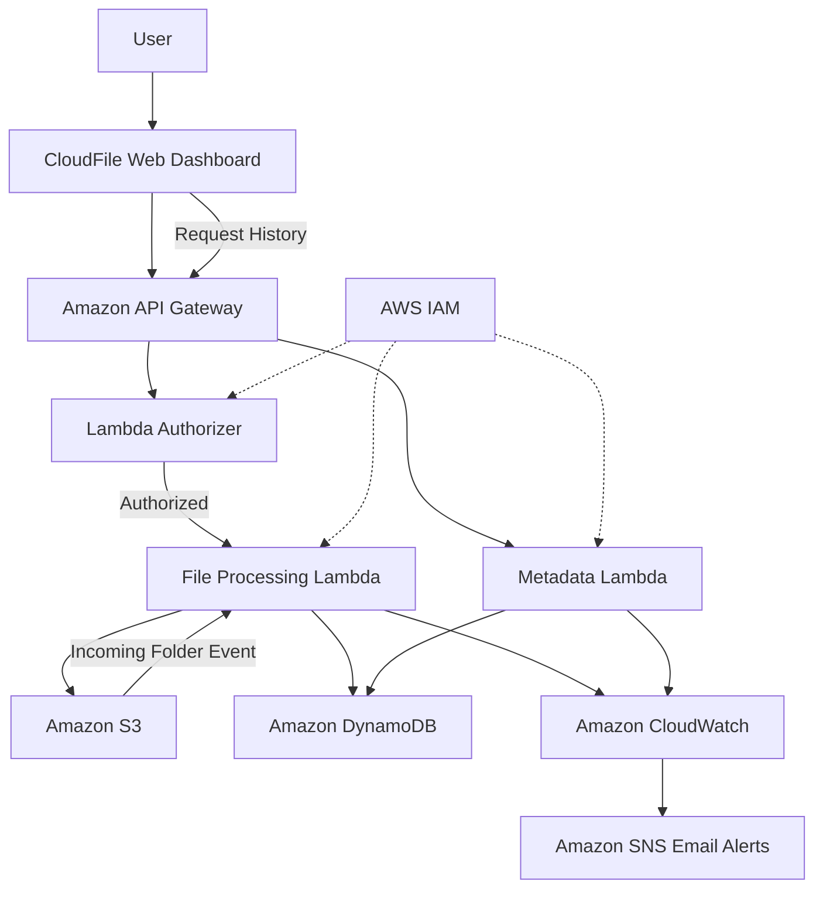
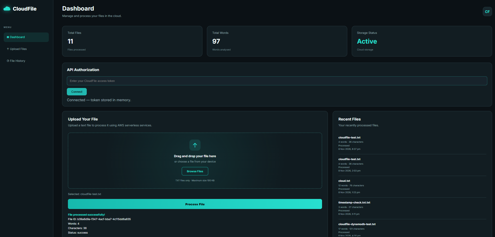
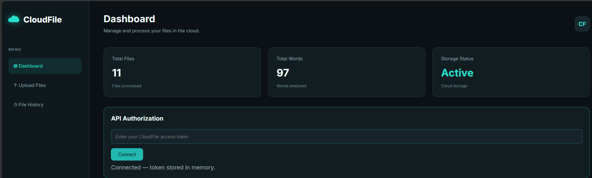
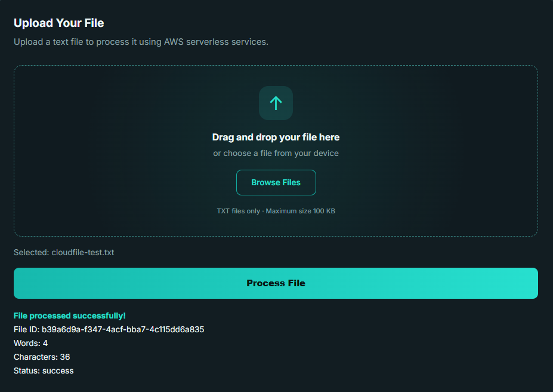
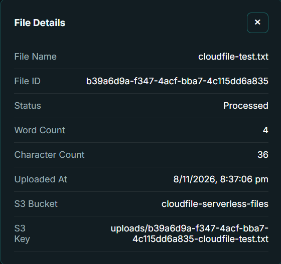

# CloudFile – Serverless File Processing System

CloudFile is a serverless file processing application built using AWS services. It allows users to upload text files, process their contents, store file metadata, and view recent upload history through a web dashboard.

## Project Overview

The application uses AWS Lambda for processing, Amazon S3 for file storage, Amazon DynamoDB for metadata management, and Amazon API Gateway to expose the backend APIs.

## AWS Services Used

- **Amazon S3:** Stores uploaded files.
- **AWS Lambda:** Processes files and handles API requests.
- **Amazon DynamoDB:** Stores file metadata and processing details.
- **Amazon API Gateway:** Provides HTTP endpoints for upload and metadata retrieval.
- **Amazon CloudWatch:** Monitors Lambda execution and errors.
- **Amazon SNS:** Sends email alerts for Lambda errors.
- **AWS IAM:** Controls permissions between AWS services.

## Key Features

- TXT file upload through a web dashboard.
- File content processing and word/character counting.
- Metadata storage in DynamoDB.
- Recent file history and file details.
- File size and input validation.
- Token-based API authorization using a Lambda authorizer.
- CloudWatch error monitoring and SNS email alerts.
- Private S3 bucket with server-side encryption.

## Architecture Flow

1. User uploads a TXT file through the frontend.
2. API Gateway receives the request.
3. Lambda authorizer validates the access token.
4. The processing Lambda validates and processes the file.
5. Amazon S3 stores the uploaded file.
6. DynamoDB stores its metadata.
7. The metadata API retrieves recent file records for the dashboard.

## Security

- S3 Block Public Access is enabled.
- Server-side encryption is enabled.
- IAM permissions restrict access to required AWS resources.
- API routes require token authorization.
- Input validation helps prevent invalid uploads.

**Note:** The current token-based authorization is intended for a private demonstration. It is not a complete production user-authentication system.

## Technologies

AWS, Python, HTML, CSS, JavaScript, Amazon S3, AWS Lambda, DynamoDB, API Gateway, CloudWatch, SNS and IAM.

## Project Screenshots

### Complete Dashboard View

### Dashboard

### Successful File Upload

### File Details

## Testing and Validation

The application was tested with the following scenarios:

- Successful TXT file upload.
- Empty file content validation.
- Missing filename validation.
- Invalid JSON request handling.
- File size limit validation (100 KB).
- Unsupported file type rejection.
- API authorization with valid and invalid tokens.
- Metadata retrieval and recent upload history.

## Project Status

Completed core implementation and tested file uploads, metadata retrieval, input validation, and API authorization.
